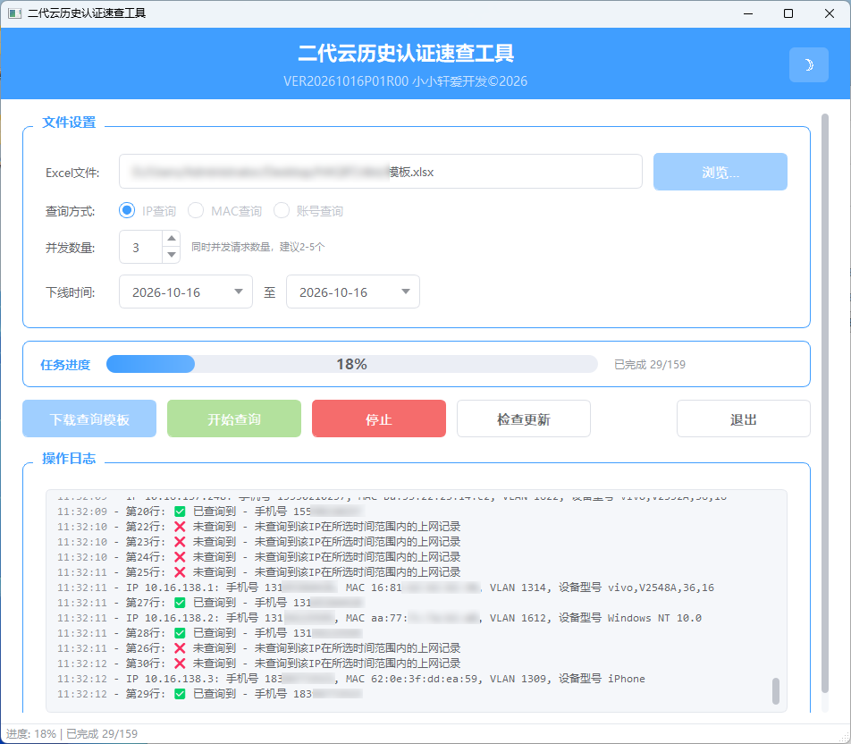
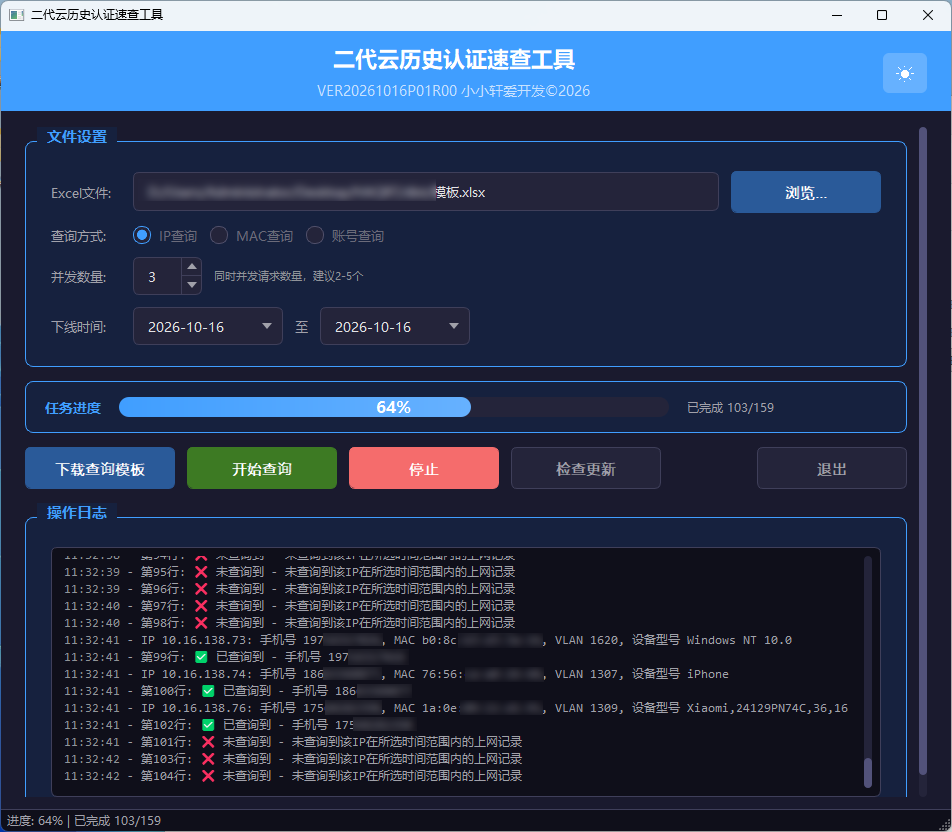

# 二代云历史认证速查工具

用于批量检测寰创（GBCOM）二代云平台对项目批量查询历史设备最后上线下线相关信息，支持Excel批量导入并将结果回写至 Excel 文件。

## 功能介绍

- **批量账号检查**：从 Excel 文件读取查询项字段（支持设备IP、设备MAC、用户账号三种查询模式），自动登录 GBCOM 管理系统，逐个查询账号历史认证信息
- **多线程并发**：支持 1~10 线程并发检查，每个线程使用独立的实例，显著提升批量检查效率
- **项目筛选**：支持选择目标项目，查询时仅匹配指定项目下的结果，避免多项目数据混淆
- **自动重试**：对服务端无响应、操作频繁等异常情况自动重试最多 3 轮，提高检查成功率
- **结果回写**：校验结果自动写入 Excel 文件；若原文件被占用，自动另存为 `xxx_查询结果.xlsx`
- **模板下载**：一键导出查询模板 Excel 文件，规范输入格式
- **亮色/暗色主题**：提供两套完整的界面主题，可随时切换
- **防系统休眠**：运行期间自动阻止 Windows 进入睡眠状态，避免长时间任务中断
- **便携版 Chrome**：内置便携版 Chrome 浏览器，无需用户额外安装浏览器环境，无需手动获取cookie字段即可登录

## 运行环境

- 操作系统：Windows 10 及以上
- 内存：建议 4GB 及以上

## 使用方法

直接运行exe文件即可，无需额外安装依赖

### 操作流程

1. 启动程序，选择查询字段模式
2. 点击「下载查询模板」获取 Excel 模板，填入待检查的查询项列
3. 选择填好账号的 Excel 文件
4. 在弹出的浏览器中手动登录 GBCOM 系统
5. 登录成功后在软件中点击确定并选择目标项目
6. 设置并发线程数，点击「开始检查」
7. 检查完成后查看 Excel 文件中的结果

## 注意事项

- 单次检测不建议太多账号，建议分批检测
- 首次运行需等待便携版 Chrome 解压，请耐心等待

## 运行截图

